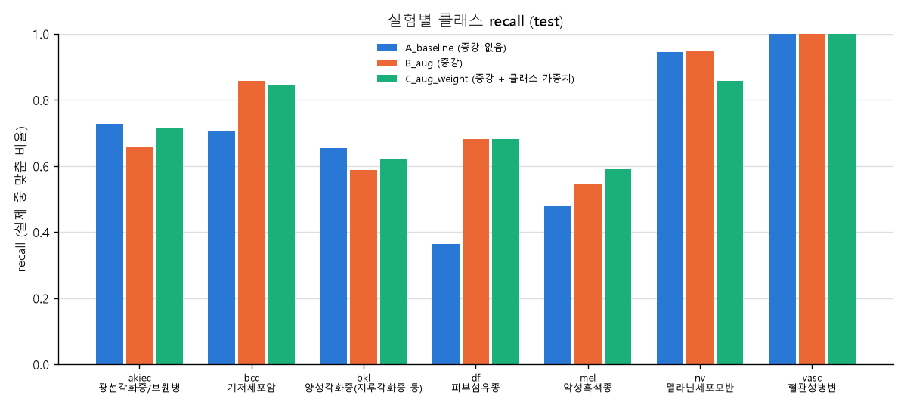

# HAM10000 피부 병변 분류 실험

이번 HAM10000 실험의 코드와 결과 공유용 폴더입니다. 저장소 루트의 기존 AIHUB/PAD-UFES-20 실험과 구분하여 보관합니다.

- `src/`: 최신 3차 실험 코드. `src/v2_resnet50_1013/`는 2차 3분류 코드, `src/ham7_old/`는 7종 분류 코드, `src/aihub_old/`는 AIHUB 코드 보관용입니다.
- `outputs_3cls_v3/`: 2026-10-20의 ConvNeXt-Tiny 및 ResNet50 실험 결과와 모델 가중치.
- `outputs_3cls/`: 2026-10-13의 3분류 실험 10개 결과와 모델 가중치.
- `outputs/`: A/B/C 모델 가중치(`best.pt`), 학습 이력, 시험 평가 결과, 혼동행렬, 비교표와 그래프.
- 원본 데이터는 포함하지 않습니다. HAM10000을 이 폴더의 `data/` 아래에 압축 해제하면 됩니다.

## 최신 3차 실험 (2026-10-20)

모델별 기본 학습과 증강 효과를 비교했습니다. ConvNeXt-Tiny 6개 조건(기본, 뒤집기, 회전, 자르기, CutMix, 조합)과 ResNet50 2개 조건(기본, 조합), 총 8개 본 실험입니다. 본 실험 모두 50 epoch 학습과 동일한 시험 이미지 1,059장 평가를 완료했습니다. `_smoke/`는 1 epoch 연습 실행 결과이며 본 실험 결과표에서 제외합니다.

공통 설정은 ImageNet 사전학습, 입력 224px, 배치 16, AdamW 초기 학습률 1e-4, weight decay 0.05, cosine scheduler, AMP bf16입니다. 각 모델은 검증 balanced accuracy가 가장 높은 epoch를 선택했습니다.

[3차 전체 결과표 및 모델 비교](outputs_3cls_v3/결과표.md)에 실험별 recall, precision, F1, AUC, accuracy를 정리했습니다. 전체 행의 recall은 balanced accuracy이고, 클래스별 accuracy는 one-vs-rest 이진 정확도입니다. 괄호는 ConvNeXt-Tiny 기본 실험(`00_baseline`) 대비 차이(%p)입니다. 실험별 폴더에 모델, 설정, 학습 이력, 평가 결과 및 혼동행렬을 포함합니다.

### 3차 모델 다운로드 및 실행

`outputs_3cls_v3/`의 `.pt` 파일은 Git LFS로 저장합니다. Git으로 저장소를 받은 뒤 모델 원본이 필요하면 Git LFS가 설치된 환경에서 다음을 실행합니다.

```bat
git lfs install
git lfs pull
```

GPU용 PyTorch와 torchvision이 설치된 환경을 활성화하고, 이 프로젝트 폴더에서 실행합니다. 원본 HAM10000 데이터는 별도로 `data/` 아래에 준비합니다.

```bat
python -m pip install -r requirements.txt
run_all.bat
```

자세한 순서는 [팀원 실행 안내](팀원_실행안내.md)를 참고합니다. `run_all.bat`은 데이터 준비, 연습 실행, 본 실험 8개를 수행하고 `outputs_3cls_v3/결과표.md`를 갱신합니다. 재실행은 같은 이름의 3차 모델과 결과를 새로 생성합니다.

저장된 모델만 재평가하려면 다음을 실행합니다.

```bat
python src/prepare_split.py --data data
python src/evaluate.py --data data --ckpt outputs_3cls_v3/00_baseline/best.pt
python src/compare.py --out outputs_3cls_v3
```

## 이전 2차 3분류 실험 (2026-10-13)

HAM10000 사진 5,310장을 모반(nv), 기타 양성(bkl/df/vasc), 악성·전암(mel/bcc/akiec)으로 묶어 학습했습니다. 코드와 결과표에서는 이 그룹을 각각 `normal`(정상/점), `benign`(양성), `malignant`(악성)으로 표시합니다. `normal`은 병변 없는 일반 피부 사진을 뜻하지 않습니다.

공통 설정은 ImageNet 사전학습 ResNet50, 입력 224px, 배치 32, 20 epoch, Adam 초기 학습률 1e-4, 클래스 가중치 없음입니다. 병변 단위로 나누고 검증 balanced accuracy가 가장 높은 모델을 선택했습니다. 10개 실험 모두 20 epoch 학습과 시험 이미지 1,059장 평가를 완료했습니다.

[3분류 전체 결과표](outputs_3cls/결과표.md)에는 클래스별 recall, precision, F1, one-vs-rest AUC와 전체 accuracy가 있습니다. 괄호 안 수치는 기본 학습(`00_baseline`) 대비 차이(%p)입니다. 실험별 폴더에 `best.pt`, 설정, 학습 이력, 평가 결과와 혼동행렬을 포함합니다.

실험 조건은 기본 학습, 뒤집기·회전, 자르기, 색 변화, CutMix, 뒤집기·자르기·CutMix 조합, 가짜 털, 렌즈 테두리, 가림, 탄성 변형입니다. 데이터 규모와 분류 기준이 달라 7종 실험과 정확도를 직접 비교하지 않습니다.

### 2차 결과 재평가

이 폴더에서 GPU용 PyTorch와 torchvision이 설치된 환경을 활성화하고 실행합니다. 원본 HAM10000 데이터는 별도로 `data/` 아래에 준비합니다.

```bat
python -m pip install -r requirements.txt
python src/v2_resnet50_1013/prepare_split.py --data data
python src/v2_resnet50_1013/evaluate.py --data data --ckpt outputs_3cls/00_baseline/best.pt
python src/v2_resnet50_1013/compare.py --out outputs_3cls
```

2차 코드 전체 재실행 방법은 [2차 코드 보관 안내](src/v2_resnet50_1013/README.md)를 참고합니다. 프로젝트 루트의 `run_all.bat`은 현재 3차 실험용입니다.

## 이전 7종 시험 결과 (2026-10-06)

동일한 병변 단위 분할의 시험 이미지 1,987장으로 평가했습니다. 공통 설정은 ImageNet 사전학습 ResNet50, 입력 224px, 배치 32, 10 epoch, Adam 초기 학습률 1e-4입니다. 각 실험의 최종 평가에는 검증 balanced accuracy가 가장 높았던 모델을 사용했습니다.

| 실험 | 조건 | 정확도 | Balanced accuracy | Macro F1 | mel recall |
|---|---|---:|---:|---:|---:|
| A | 증강 없음 | 83.39% | 69.67% | 0.696 | 48.09% |
| B | 증강 | 84.70% | 75.42% | 0.749 | 54.47% |
| C | 증강 + 클래스 가중치 | 79.62% | 75.92% | 0.662 | 59.15% |

증강으로 전반적인 성능이 개선되었습니다. 클래스 가중치를 추가하면 mel 및 악성·전암 그룹 recall이 상승했으나 양성 오경고율도 증가했습니다. 단일 분할·seed의 결과입니다.

[전체 비교표](outputs/비교표.md)



### 7종 결과 재평가

이 폴더를 작업 디렉터리로 사용합니다. GPU용 PyTorch와 torchvision이 설치된 환경에서 나머지 의존성을 설치합니다.

```bat
python -m pip install -r requirements.txt
python src/ham7_old/check_data.py --data data
python src/ham7_old/prepare_split.py --data data
python src/ham7_old/evaluate.py --data data --ckpt outputs/A_baseline/best.pt
python src/ham7_old/evaluate.py --data data --ckpt outputs/B_aug/best.pt
python src/ham7_old/evaluate.py --data data --ckpt outputs/C_aug_weight/best.pt
python src/ham7_old/compare.py
```

원래 실험의 `split.csv`는 포함하지 않습니다. 분할을 재현하려면 동일한 HAM10000 메타데이터와 이미지, 기본 seed 0을 사용하고 클래스별 이미지 수 및 병변 수를 먼저 확인합니다.
